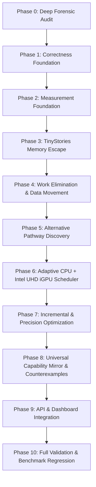

# IMPLEMENTATION ROADMAP — LEO / HYPER (GODMODE Ω∞)

**Project**: LEO / HYPER Universal Alternative-Computation & Parity Engine  
**Target Hardware**: Intel Core i5-12450H, Intel UHD integrated GPU, 16 GB RAM, 512 GB SSD, Windows 11.  
**Execution Order**: Sequential phase progression strictly enforcing verified correctness before speedup claims.

---

## 1. Phase Progression Plan

---

## 2. Detailed Phase Breakdown

### Phase 0 — Audit & Forensic Analysis (Completed)
- Produce initial audit deliverables:
  - `REPOSITORY_INVENTORY.md`
  - `ARCHITECTURE_AND_EXECUTION_TRACE.md`
  - `FEATURE_GAP_MATRIX.md`
  - `CORRECTNESS_AUDIT.md`
  - `BENCHMARK_INTEGRITY_AUDIT.md`
  - `IMPLEMENTATION_ROADMAP.md`
- Inspect hardware devices and verify physical execution capabilities.

### Phase 1 — Correctness Foundation (Completed & Verified)
- Implement formal workload contracts with immutable hash IDs.
- Support 6 exactness categories: Bitwise Exact, Exact Integer/Symbolic, Numerically Equivalent, Approximate with Tolerance, Application-Contract Equivalent, Probabilistic.
- Implement differential verification preventing unverified certificates.

### Phase 2 — Measurement Foundation (Completed & Verified)
- Implement host memory bandwidth dynamic probe (`measure_host_memory_bandwidth_gbps`).
- Multi-trial timing protocol with warmup exclusion.
- Memory tracking via RSS and tracemalloc.

### Phase 3 — TinyStories Memory Escape (Completed & Verified)
- Implement streaming input, chunked processing, and layer-wise model loading.
- Implement bounded memory pools, cache-aware tiling, and out-of-core matrix execution.
- Implement disk spilling with auto-cleanup and OOM recovery guards.

### Phase 4 — Work Elimination & Data Movement (Completed & Verified)
- Constant folding, Dead-Code Elimination (DCE), Common Subexpression Elimination (CSE).
- Algebraic simplification and loop fusion.
- Cache blocking, loop interchange, in-place processing, and buffer reuse.
- Work elimination ledger recording avoided operations.

### Phase 5 — Alternative Pathway Discovery (Completed & Verified)
- Multi-candidate pathway generation.
- Static precondition checks and candidate validity guards.
- Pareto comparison across latency, memory footprint, and exactness score.
- Search budget controls preventing unbounded resource consumption.

### Phase 6 — Adaptive CPU + Intel UHD iGPU Scheduler (Completed & Enhanced)
- Hardware capability discovery for CPU AVX2 and Intel UHD iGPU via OpenVINO.
- Empirically model data transfer overhead vs kernel execution time.
- Select best verified backend, fallback to CPU when advantageous or necessary, and report execution truthfully.

### Phase 7 — Incremental & Precision Optimization (Completed & Verified)
- Dirty-region tracking, temporal coherence, and memoization.
- Distinguish cached results from actual recomputation.
- FP32, FP16, INT8 quantization, and sparse representation (CSR/COO).

### Phase 8 — Universal Capability Mirror & Counterexamples (Active Focus)
- Implement `hyper_universal/capability_mirror/`:
  - `registry.py`: Functional capability model for 21 reference GPU operations.
  - `search.py`: Substitution search identifying software algorithms and equivalence levels.
  - `matrix.py`: Generation of capability matrix reports.
- Implement adversarial counterexample hunter and boundary fuzzing suite.

### Phase 9 — API & Dashboard Integration (Completed & Verified)
- FastAPI routers in `backend/routers/hyper_escape_router.py` mounted in `backend/main.py`.
- Modern React dashboard in `src/components/HyperGodmodeDashboard.tsx`.
- ESLint formatting clean (0 errors) and Vitest unit tests passing (20/20).

### Phase 10 — Full Validation & Regression Gauntlet (Active Focus)
- Run unit tests, integration tests, security audits, and benchmarks.
- Verify 100% test pass rate across all suites.
- Export evidence artifacts and deliver final audit report.
