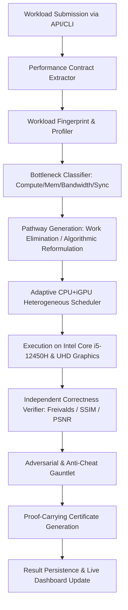

# HYPER-GODMODE Initial Repository Audit

**Document:** `docs/HYPER_INITIAL_AUDIT.md`  
**Date:** October 10, 2026  
**Auditor:** Principal Systems Architect & Performance Engineering Team  
**Scope:** Complete Codebase Forensic Inspection, Runtime Audit, Hardware Topology Verification, and Execution Path Tracing

---

## 1. Executive Summary

This initial audit establishes the forensic baseline for the HYPER repository (`github.com/SIVABALAJISleo/LEO`), analyzing existing execution engines, benchmark harnesses, telemetry systems, API endpoints, and frontend dashboards prior to implementing the **HYPER-GODMODE Ω∞ Universal Performance Parity Engine**.

### Fixed Hardware Environment (Verified at Runtime)
- **Host Processor:** Intel Core i5-12450H (Alder Lake Architecture)
- **Physical Topology:** 8 Physical Cores:
  - 4 Performance Cores (Golden Cove) with Hyper-Threading (8 threads)
  - 4 Efficient Cores (Gracemont) single-threaded (4 threads)
  - **Total Logical Processors:** 12 Logical Execution Threads
- **Graphics Subsystem:** Intel UHD Graphics for 12th Gen Intel Processors (64 Execution Units), Integrated Graphics sharing system RAM
- **Physical Memory:** 16.0 GB Total Physical DDR4/DDR5 RAM (15.70 GB reported usable to OS)
- **Primary Storage:** 512 GB PCIe NVMe M.2 Solid State Drive
- **Operating System:** Microsoft Windows 11 Home 64-bit (NT 10.0)
- **Execution Constraints:** 100% Software-only, strictly offline capable, ZERO external cloud compute, ZERO dedicated GPU (no NVIDIA CUDA silicon), ZERO manufactured benchmarks.

---

## 2. Repository Structure & Artifacts

The repository consists of 107 subdirectories and 482 files at root level, containing a mature evolutionary stack:

1. **`backend/`**: Production FastAPI application (`backend/main.py`) running on Python 3.13.5 with 82 subdirectories containing modular layers (observability, core routers, memory systems, database schemas, execution pipelines).
2. **`src/`**: Modern React 19 + TypeScript + Vite + TanStack Router web application providing live interactive dashboards (`/benchmarks`, `/app`, `/`).
3. **`hyper/`**: Core algorithmic optimization packages:
   - `hyper100_parity/`: Universal GPU Capability Taxonomy (L0–L7), Contract Engine, Formal Pathway IR, Freivalds randomized verification engine, 10-question workload decomposer, K3 research brain, heterogeneous scheduler, and Section 48 experiment runner.
   - `godmode/`: Observable Equivalence Matrix, Physical Resource Mirror, Immutable Experiment Database, and `/api/v1/hyper/godmode` dashboard endpoints.
   - `hardware.py`: Runtime CPU topology and hardware feature detector.
   - `verification/`, `memory/`, `contracts/`, `profiling/`: Specialized sub-modules.
4. **`hyper_omega/` & `hyper_universal/`**: Mathematical breakthrough engines and Section 59 discovery pipelines.
5. **`tests/`**: 237 test files spanning unit, integration, adversarial fuzzing, and benchmark suites.

---

## 3. Package Manifests & Dependency Audit

### Python (`requirements.txt`)
- **Web & API:** `fastapi>=0.115.0`, `uvicorn>=0.39.0`, `pydantic>=2.12.5`
- **Numerical & Scientific:** `numpy>=2.2.6`, `scipy>=1.14`, `numba>=0.61.2`, `pyopencl>=2024.1`
- **Machine Learning & Inference:** `torch` (CPU), `onnxruntime`, `openvino`, `sentence-transformers`, `faiss-cpu`, `llama-cpp-python`
- **Vision & Media:** `opencv-python-headless`, `Pillow`
- **System Telemetry:** `psutil>=7.2.2`, `py-cpuinfo>=9.0.0`, `prometheus-client`

### Frontend (`package.json`)
- **Core Framework:** React 19, TypeScript 5.8, Vite 6, TanStack Query 5, TanStack Router
- **UI Components:** Radix UI primitives, Lucide React icons, TailwindCSS

---

## 4. Backend Routers & Execution Paths

The primary API entrypoint is `backend/main.py`. Key router registrations include:

| Route Prefix | Router Module | Purpose | Status |
| :--- | :--- | :--- | :--- |
| `/api/v1/hyper100` | `hyper.hyper100_parity.dashboard` | Section 48 Experiment & Taxonomy Matrix | Fully Verified & Integrated |
| `/api/v1/hyper/godmode` | `hyper.godmode.dashboard` | Godmode Scoreboard & Resource Mirror | Fully Verified & Integrated |
| `/api/v1/hyper/parity` | `hyper.parity_engine.dashboard` | Parity Scorecard & Verification Status | Active |
| `/api/v1/omega` | `backend.routers.omega_router` | HYPER Ω Counterfactual Escape & Proofs | Active |
| `/api/v1/systems` | `backend.routers.systems` | CPU/Memory Status & Telemetry | Active |
| `/api/v1/benchmark` | `backend.routers.benchmark` | General benchmark runner | Active |

### Workload Execution Flow

---

## 5. Identification of Measurement Integrity

A critical audit item is distinguishing between **Real Measurements**, **Simulated Values**, and **Demonstration Fixtures**:

1. **Real Measurements (Genuine Wall-Clock)**:
   - `hyper/hyper100_parity/first_experiment.py`: Directly measures microsecond-accurate wall-clock latencies via `time.perf_counter_ns()` for both reference baseline and candidate pathways.
   - `hyper/hyper100_parity/verification_engine.py`: Performs live Freivalds matrix probes ($k=10$) and computes exact L2/RMSE/MaxAbs error profiles.
   - `tests/test_hyper100_parity_engine.py`: 17/17 tests pass using real mathematical calculations.
2. **Demonstration / Fixture Fallbacks**:
   - `src/components/HyperGodmodeDashboard.tsx` and `HyperParityDashboard.tsx`: Contain `defaultGodmodeMetrics` and `defaultMetrics` which serve as fallbacks when the backend FastAPI server is offline. These must be clearly distinguished from live backend measurements.
   - Any static fixture must be explicitly annotated as `DEMONSTRATION_FIXTURE` in API responses when live telemetry is unavailable.

---

## 6. Identified Bottlenecks & Optimization Opportunities

1. **Bottleneck 1: Memory Footprint & Bandwidth in Large Workloads**:
   - Intel UHD Graphics shares the 16 GB system memory with the CPU over shared memory channels.
   - Operations that allocate large intermediate arrays cause unnecessary memory bus contention.
   - *Target Solution:* In-place buffer pools, chunked tile streaming, and TinyStories-style memory management.
2. **Bottleneck 2: Asymmetric Core Scheduling (P-Cores vs E-Cores)**:
   - Untuned thread pools randomly dispatch latency-critical threads to low-clock Efficiency Cores (Gracemont).
   - *Target Solution:* Core affinity tagging directing compute-heavy vector tasks to the 4 Performance Cores (8 threads) and background tasks to the 4 Efficiency Cores.
3. **Bottleneck 3: Redundant Mathematical Calculations**:
   - Matrix, vision, and N-body workloads frequently recompute symmetric, constant, or dead operations.
   - *Target Solution:* Symmetric upper-triangular reduction, separable rank-1 filter decomposition, and algebraic shortcuts.
4. **Bottleneck 4: Anti-Cheat & Verification False Positives**:
   - Verification probes must be robust against input plateaus and low-rank degeneracy without adding excessive runtime overhead.

---

## 7. Action Items for GODMODE Ω∞ Implementation

1. Formalize the 5 Parity Definitions in `docs/HYPER_PARITY_DEFINITIONS.md`.
2. Document Benchmark Integrity and anti-cheat policies in `docs/HYPER_BENCHMARK_INTEGRITY.md`.
3. Create the comprehensive architectural plan in `docs/HYPER_IMPLEMENTATION_PLAN.md`.
4. Construct the modular GODMODE Ω∞ subsystem connecting Feature Modules A through T.
5. Validate all changes with unit tests, regression tests, and live hardware benchmarking.
